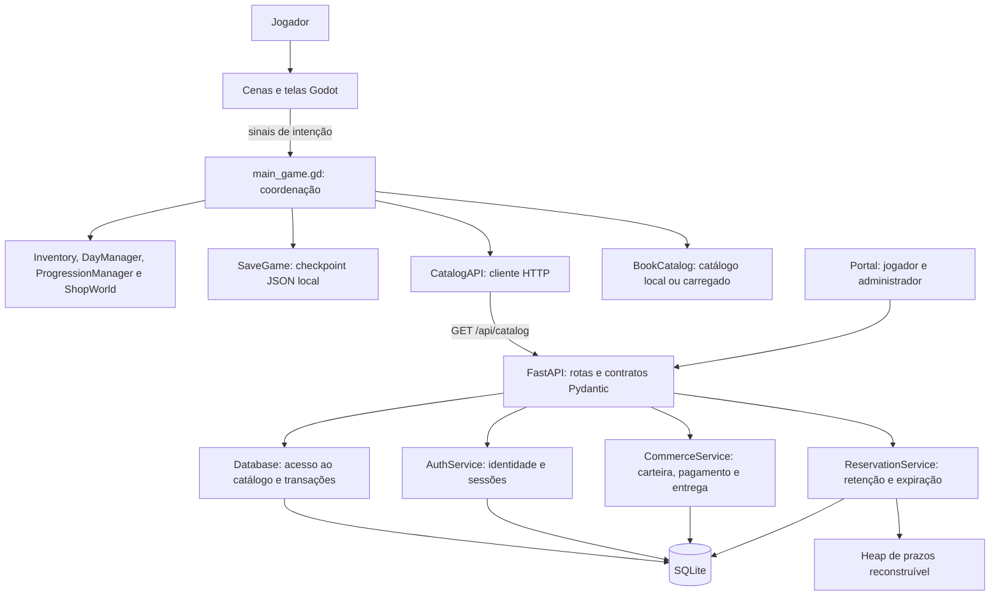

# Arquitetura e evolução funcional

Este documento descreve a implementação encontrada no código do projeto Biblioteca. As decisões correspondentes estão em [ADRS.md](ADRS.md).

## Escopo e referência da entrega 1

O projeto combina um jogo local em Godot com uma API de catálogo em Python. A arquitetura atual usa módulos com responsabilidades distintas, comunicação por sinais no jogo e uma fronteira HTTP entre jogo e catálogo persistente.

A referência de desempenho descrevia reservas de assentos com expiração em oito minutos. A adaptação autorizada aplica o cenário a **exemplares de livros**, com dispersão dos prazos de liberação, processamento em lotes, marcação e liberação em etapas separadas e índice de prazos em memória. As metas são liberar 100% das unidades em até cinco segundos e limitar o acréscimo de latência das outras operações a 20%. Os resultados medidos estão no [cenário de reservas](CENARIO_RESERVAS.md) e no [relatório de validação](VALIDACAO.md).

O PDF de documentação e fluxograma fornecido depois define jogador, administração, autenticação, pagamento e banco de itens. A entrega adapta itens para livros e, conforme orientação recebida, usa contas locais e moedas fictícias. O portal da API implementa a jornada autenticada de reserva, pagamento e entrega; o Godot implementa a simulação de atendimento e consulta o mesmo catálogo. A [matriz de requisitos](REQUISITOS.md) identifica os componentes e os limites dessa correspondência.

O estilo implementado é **cliente-servidor com organização modular por responsabilidades**. Autenticação, comércio e expiração são serviços dedicados no mesmo processo Python, com persistência comum; não são microserviços implantados separadamente. O documento original não determina um estilo formal como MVC ou microserviços. A implementação também não é MVC estrito: `main_game.gd` concentra orquestração e ainda constrói partes da interface.

## Organização implementada

| Responsabilidade | Arquivos principais | Papel e fronteira |
| --- | --- | --- |
| Apresentação | `scenes/`, `scripts/inventory_screen.gd`, `scripts/game_menu.gd`, `scripts/workshop_screen.gd` | Cenas, controles, entrada do jogador e emissão de intenções. Algumas telas consultam diretamente objetos do jogo; a separação não é absoluta. |
| Coordenação | `scripts/main_game.gd`, carregado por `scripts/main.gd` | Conecta sinais, abre telas, coordena dias, vendas, catálogo e checkpoints. |
| Regras e estado | `scripts/inventory.gd`, `scripts/day_manager.gd`, `scripts/progression_manager.gd`, `scripts/shop_world.gd`, `scripts/restoration_jobs.gd` | Estoque, tempo do expediente, metas, melhorias, reservas e ciclo das encomendas de restauro. Predominam objetos `RefCounted`, sem dependência de cenas de interface. |
| Personagem interativo | `scripts/customer.gd`, `scripts/interactable.gd` | Atendimento e reações do personagem dentro da árvore de cenas. `Customer` combina regras de aceitação com comportamento visual. |
| Integração e persistência do jogo | `scripts/catalog_api.gd`, `scripts/book_catalog.gd`, `scripts/save_game.gd` | HTTP, adaptação dos registros do catálogo e leitura/gravação do progresso JSON. |
| Interface HTTP | `api/main.py`, `api/models.py` | Rotas CRUD, paginação, validação Pydantic e tradução de falhas para respostas HTTP. |
| Persistência do catálogo | `api/database.py`, `api/schema.sql`, `api/seed.json` | Consultas parametrizadas, transações, relações por bairro e carga inicial. A classe `Database` também valida invariantes de jogabilidade. |

Os dados de uma partida e os dados do catálogo têm ciclos de vida diferentes. O SQLite mantém livros, clientes e fornecedores. O JSON do Godot mantém moedas, estoque, progresso e uma cópia do catálogo utilizado pela partida. A API não recebe as vendas de atendimento aos personagens e não funciona como servidor multiplayer.

A extensão acrescenta `AuthService` (`api/auth.py`), `CommerceService` (`api/commerce.py`) e `ReservationService` (`api/reservations.py`). `commerce_router.py` aplica autenticação e papéis às rotas. `portal.html` é a interface do jogador e do administrador. Carteiras, sessões, estoque compartilhado, pagamentos e livros entregues são persistidos no SQLite. O débito, a confirmação da reserva e a entrega de uma compra ocorrem em uma única transação, com chave de idempotência.

O administrador configura nome da livraria, saldo inicial das novas contas do portal e limite de clientes. As configurações acompanham o catálogo HTTP e seu snapshot; o Godot aplica o limite na abertura dos dias e o preserva ao continuar offline. **Toda nova partida Godot começa com zero moedas**, com ou sem API, independentemente do saldo inicial configurado para o portal. Carteira do portal e moedas da simulação são estados distintos, explicitados na interface e no guia de uso. Continuar uma partida recupera seu saldo salvo.

O limite diário se aplica às visitas comuns e também respeita o número de leitores do bairro. Retiradas de restauro já agendadas podem acrescentar vagas, preservando os compromissos existentes.

## Padrões de projeto comprovados

### Observer por sinais do Godot

Emissor e assinante se comunicam por eventos, sem o emissor precisar conhecer todas as reações.

- `Inventory.changed` é emitido após adição e remoção de exemplares.
- `DayManager.customer_ready` e `store_closed` anunciam os acontecimentos do expediente; `main_game.gd` conecta os sinais em `_ready()`.
- `InventoryScreen` emite `deliver_requested`, `negotiate_requested`, `offer_requested` e `reservation_requested`. `_open_inventory()` em `main_game.gd` conecta as intenções às operações do jogo.
- `GameMenu` emite `new_game_requested`, `continue_requested` e `relaxed_changed`.

Isso permite acrescentar uma reação a um evento, como feedback visual, sem alterar o código emissor. Ainda é preciso conectar e controlar a vida útil dos assinantes.

### Simple Factory por funções de criação

Em `api/main.py`, `resource_router(database, resource, schema, administrator)` concentra a construção de rotas CRUD para os recursos registrados em `api/models.py::MODELS`. A mesma fábrica cria os contratos de paginação e atualização parcial com `create_model`. `create_app(database_path)` compõe a aplicação com uma instância de banco específica, usada inclusive por testes com banco temporário.

O benefício é reutilizar o fluxo de criação e evitar três implementações quase iguais para livros, clientes e fornecedores. Trata-se de uma fábrica simples baseada em funções; não é uma hierarquia GoF de Factory Method. Um recurso com comportamento distinto pode exigir sua própria rota e alterações no armazenamento.

### Outros mecanismos de organização

`Database` centraliza o acesso ao SQLite e funciona como uma fachada de persistência, mas não implementa uma interface abstrata de Repository. `restoration_jobs.gd` possui uma máquina de estados explícita com transições validadas; não há classes distintas para cada estado do padrão GoF State. Esses mecanismos são descritos sem atribuir ao projeto padrões que ele não implementa.

## Exemplo de fluxo

1. O jogador escolhe **Entregar** no estoque.
2. `InventoryScreen` emite `deliver_requested(book_id, condition)`.
3. O coordenador chama `_handle_stock_action()`, verifica o exemplar e a reserva e consulta a reação do cliente.
4. `_complete_stock_action()` aplica o resultado em estoque, moedas, reputação e metas e atualiza a interface.
5. Nos momentos definidos pelo jogo, `_save_checkpoint()` coleta os estados e `SaveGame.write_save()` grava o JSON.

Não há requisição HTTP por venda. O catálogo é obtido na abertura do menu. Novos jogos podem usar os dados carregados; ao continuar, prevalece a cópia guardada no salvamento.

## Extensão de funcionalidades

| Evolução | Ponto de extensão existente | Alterações e verificações necessárias |
| --- | --- | --- |
| Novos títulos | CRUD `/api/books` e `BookCatalog` | Cadastrar preço, temas e bairros válidos; capa deve existir em `bookimg/` ou ficar vazia. Iniciar nova partida e verificar busca, atendimento, compra e condição. O catálogo local também pode ser ampliado no código. |
| Novos clientes com artes existentes | CRUD `/api/customers` | Usar cena, personalidade e condição já aceitas pelo contrato; conferir compatibilidade de temas e bairros. Arte inédita exige acrescentar cena e atualizar a lista permitida em `api/models.py` e a validação do jogo. |
| Novos fornecedores | CRUD `/api/suppliers` | Definir fator de preço, risco e temas. Preservar ao menos um fornecedor de encomendas especiais. Conferir ofertas reunidas e compras. |
| Eventos e melhorias | `ShopWorld.EVENTS` e `UPGRADES` | Acrescentar dados e, quando houver um novo efeito, sua regra e sua apresentação. Conferir persistência e recompensa única. |
| Novas atividades | Módulo de regra próprio e tela com sinais | Instanciar e conectar no coordenador; serializar estado quando necessário e acrescentar testes do comportamento. O restauro exemplifica decomposição em ferramentas e diagnósticos. |
| Novo diagnóstico de restauro | `RestorationDiagnosis.PROFILES` | Recombinar etapas já existentes por dados. Uma ferramenta inédita requer implementação, interface e testes novos. |
| Novo bairro ou nova condição | Catálogo e contratos compartilhados | Atualizar listas e validações na API, no jogo e nos testes. Não é uma configuração exclusivamente administrativa. |

Essa preparação atende à evolução de conteúdo e funcionalidades em um aplicativo local: regras importantes já têm módulos próprios, há sinais para integração e contratos comuns para cadastro. Não significa extensibilidade ilimitada ou carga distribuída.

## Limites e próximos passos

- `main_game.gd` continua extenso e concentra diversos fluxos. Se o jogo crescer, extrair serviços de atendimento, mercados e checkpoints reduz o impacto de alterações nesse arquivo.
- Há catálogos locais e semente da API. A ferramenta `tools/export_catalog.gd` ajuda a sincronizá-los, mas mudanças precisam ser conferidas nas duas formas de execução.
- SQLite e a validação de todo o catálogo após alterações são adequados ao tamanho atual. Não há alegação de escala horizontal, múltiplos servidores ou alta concorrência de gravação.
- A API usa identidades locais, sessões revogáveis e papel administrativo para mutações. O setup continua local; não há provedor externo de identidade, processamento de dinheiro real ou implantação distribuída.
- Dados genéricos em dicionários agilizam extensão, mas exigem validação e testes para impedir incompatibilidades entre salvamentos, catálogo e telas.
- Não há contrato de plugins nem inversão de dependência completa. As referências concretas por `preload` são deliberadas e visíveis.

## Verificação das decisões

Os comandos e testes disponíveis estão no [guia de testes](../tests/README.md) e no [guia da API](../api/README.md). A existência dos testes não é um resultado de execução: os resultados da verificação desta entrega devem ser consultados no relatório de validação que acompanha o pacote.

